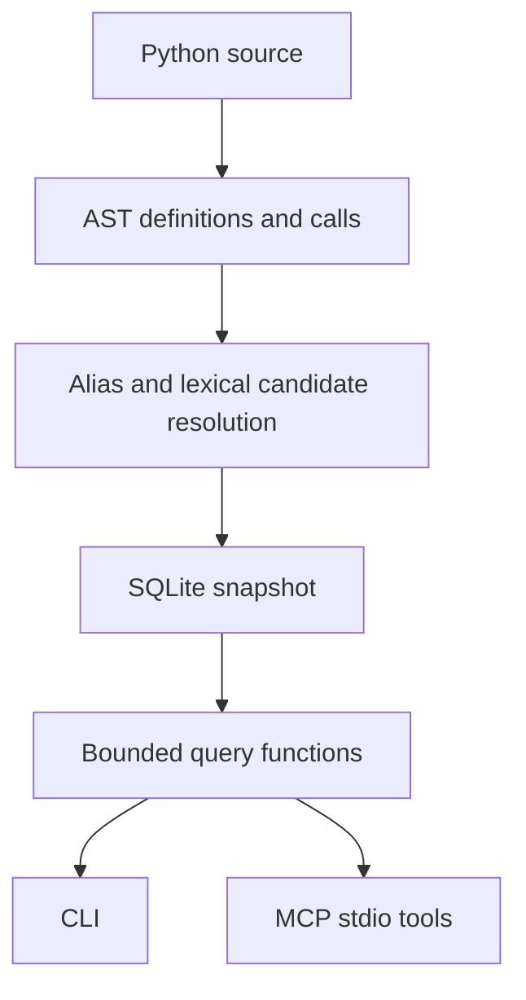

# CodeAtlas MCP

**Local structural context for Python repositories.** Index definitions and static call candidates once, then ask focused questions through MCP instead of pasting whole files.

Built by **Neeli Yaswanth Kumar** as an independent portfolio project.

## What works today

- Python functions, async functions, nested definitions and classes indexed in SQLite.
- Direct-name and module-level import-alias call candidates, including relative imports.
- Incoming/outgoing graph queries with depth and edge limits.
- Potentially impacted tests found by walking reverse call candidates.
- Symbol lookup and module summaries containing signatures, line ranges and short docstrings.
- A real stdio MCP server, CLI, protocol integration test and reproducible synthetic benchmark.

The first release uses Python's standard-library `ast`, not Tree-sitter. It is **Python-only**, with no embeddings, language model or paid API. SQLite is the graph store; traversal uses Python sets and queues.

## Quick start

Python 3.10 or newer:

```bash
git clone https://github.com/kyaswanthneeli-stack/codeatlas-mcp.git
cd codeatlas-mcp
python3 -m venv .venv
source .venv/bin/activate
python -m pip install -e .
python -m codeatlas.cli /absolute/path/to/your/repo index
python -m codeatlas.cli /absolute/path/to/your/repo find calculate
```

After indexing, copy an exact symbol ID from `find`, then query:

```bash
python -m codeatlas.cli /absolute/path/to/repo summary src/service.py
python -m codeatlas.cli /absolute/path/to/repo graph src/service.py:calculate
python -m codeatlas.cli /absolute/path/to/repo tests src/service.py:calculate
```

IDs use `relative/file.py:Qualified.name`. Source files are parsed as text and never imported or executed. Reindex after editing or deleting files; the index is a snapshot, not a file watcher.

## MCP connection

Add a stdio server to a compatible MCP client, replacing both absolute paths:

```json
{
  "mcpServers": {
    "codeatlas": {
      "command": "/absolute/path/to/codeatlas-mcp/.venv/bin/python",
      "args": ["-m", "codeatlas.server"],
      "env": {"CODEATLAS_ROOT": "/absolute/path/to/your/repo"}
    }
  }
}
```

Run `index_repository` first. Server registration follows the MCP Python SDK v1 interface (`mcp>=1.12,<2`). Client configuration syntax can differ; this is the common `mcpServers` form. No changes are made to a user's local MCP client automatically.

| Tool | Inputs | Result |
| --- | --- | --- |
| `index_repository` | none | Full rebuild statistics and per-file parse errors |
| `find_symbols` | query, limit | Stable IDs, signatures and line ranges |
| `summarize_module` | repository-relative path, limit | Indexed definitions and docstrings |
| `get_call_graph` | symbol ID, depth, direction, max_edges | Static call candidates and unresolved outgoing calls |
| `find_impacted_tests` | symbol ID, depth | Potential test callers, not guaranteed coverage |

## Example

Given `maths.py`:

```python
def add(a, b):
    return a + b

def twice(x):
    return add(x, x)
```

and `test_maths.py`:

```python
from maths import twice as double

def test_twice():
    assert double(2) == 4
```

`get_call_graph("maths.py:twice")` returns a static candidate from `twice` to `add`. `find_impacted_tests("maths.py:add")` follows incoming candidates to `test_twice`. A dynamic `obj.method()` call remains unresolved.

## Architecture



The MCP layer owns transport and input schemas. The index layer owns parsing, storage and queries. A full rebuild replaces indexed rows in a transaction. Deleted files disappear from the new snapshot. Syntax errors are reported and excluded from that snapshot; stale rows are not silently retained.

## Tests

```bash
python -m unittest discover -s tests -v
```

Includes 15 index/query tests and a real stdio integration test: spawn the server, initialize an MCP session, discover all five tools, index a fixture and query a symbol. Tests cover aliases, nested definitions, relative imports, cycles, deleted files, parse errors, duplicate IDs, root binding, path escapes and symlinks.

## Benchmark you can reproduce

```bash
PYTHONPATH=. python benchmarks/run.py
```

The checked-in `benchmarks/results.json` records the actual run and Python version. It generates 100 files × 500 lines, builds the index and measures 100 warm graph queries.

**Interpret the size comparison carefully:** the baseline is one complete 500-line module; the result is a small call graph JSON. The corpus is deliberately comment-heavy. Byte reduction does not mean token savings, equal information, better answers or lower total agent cost. No tokenizer, LLM or task-quality evaluation is used. Indexing overhead and cold queries are not included in warm-query latency.

## Important limitations

- This is syntactic candidate resolution, not complete Python name binding or type analysis. Shadowed names, reassignment and conditional imports can produce incorrect candidates.
- Method dispatch, inheritance, callbacks, decorators, reflection, wildcard imports and dynamic imports are not resolved.
- Class bodies, module-level executable calls and function default/decorator execution are not fully represented in the graph.
- Duplicate symbol IDs within a file are omitted rather than guessed. Re-export chains are not followed.
- No `.gitignore` parser, incremental file watcher or content-aware secret scanner. Common generated folders and symlinks are skipped. UTF-8 `.py` files only; 1 MB per-file cap.
- Signatures and docstrings can contain sensitive source information. Only connect repository roots you intend your MCP client to inspect. The local database is not encrypted.
- Potentially impacted tests are candidate reverse callers, not verified coverage. Unresolved edges create false negatives.
- Graph queries are bounded but indexing an entire repository is not a hardened sandbox for hostile code inputs. Treat this as a local development tool.

## Next milestones

Tree-sitter language adapters; incremental indexing; binding-aware resolution; graph precision/recall fixtures; tokenizer-aware payload measurement; end-to-end coding-agent task comparisons. These are planned, not implemented.

[Python AST documentation](https://docs.python.org/3/library/ast.html) · [MCP Python SDK v1](https://py.sdk.modelcontextprotocol.io/v1/) · [Portfolio](https://kyaswanthneeli-stack.github.io/)
