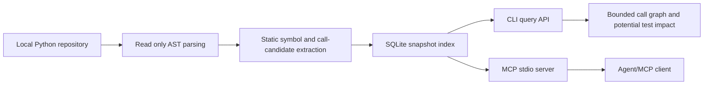

# CodeAtlas MCP: architecture and benchmark

## Architecture



## Reproducible tokenizer measurement

Existing `benchmarks/run.py` uses a 50k-line **synthetic comment-heavy** corpus and compares byte payload sizes. It does not measure model tokens. For actual tokenizer counts on an existing Python repository:

```bash
python -m pip install -e . 'tiktoken>=0.7,<1'
python benchmarks/token_benchmark.py --root . --output benchmark-token-results.json
# Other repository example (only repositories you have permission to inspect):
python benchmarks/token_benchmark.py --root /path/to/real/python/repository --max-symbols 30
```

`token_benchmark.py` builds a local index, deterministically selects symbols with call sites, counts full source-file tokens and returned graph JSON tokens with **tiktoken cl100k_base** and includes the raw per-symbol counts. The GitHub Actions workflow runs it against this actual CodeAtlas repository and uploads the resulting JSON as a build artifact.

**Interpretation:** A full source file contains implementation detail that a call graph omits. These are *not equal-information outputs*. A lower graph payload does not establish agent cost reductions, a successful coding task, or even improved context relevance. Repeated source files can be counted more than once, so totals are not corpus-wide token savings. For a meaningful agent benchmark, compare tasks on a held-out repository, track all tool and LLM tokens, answer correctness, success rate, index overhead, and latency.

## Recruiter walkthrough (five minutes)

1. Explain how AST parsing reads source without importing/executing it.
2. Index a small permissively licensed example repository and search for a function.
3. Query outgoing call candidates; show unresolved method dispatch rather than fabricate dependencies.
4. Query reverse edges and potentially impacted tests. Emphasize these are candidates, not coverage.
5. Run the unit suite and stdio MCP protocol integration test.
6. Run the tokenizer benchmark and explain *exactly what it does and does not measure*.

The Pages graph is a fixed browser example, not a browser-based MCP server. MCP should normally run locally against source that users control. Do not publish private code or database indexes in a public demo. Video walkthroughs should show a real terminal recording with sample code, not just the static mock.
